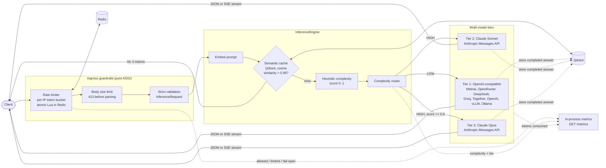
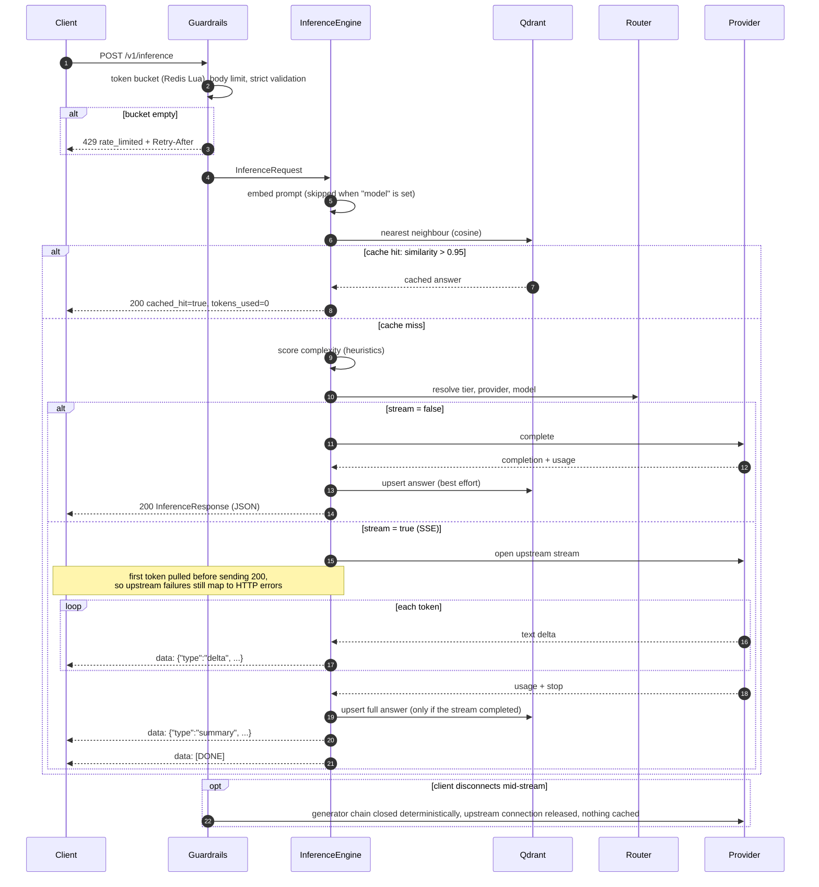

# ai-inference-gateway

**AI Systems Blueprint: repository 01/20.** An asynchronous FastAPI gateway that
sits in front of LLM providers. It answers repeated questions from a **Qdrant
semantic cache**, sends each new prompt to the **cheapest model tier that can
handle it** (Mistral / OpenRouter-class models for simple prompts, Claude Sonnet
or Opus for complex ones), **rate-limits every client** with a Redis token
bucket, and streams tokens back over **Server-Sent Events**.

- **Fewer paid calls:** near-duplicate prompts (cosine similarity strictly
  above 0.95) are served from the cache with zero provider tokens.
- **Right-sized models:** a deterministic, linear-time heuristic scores prompt
  complexity and routes it to tier 1, 2 or 3.
- **Safe by construction:** strict, closed Pydantic v2 contracts at every
  boundary; typed errors that never leak keys, URLs or inputs; a non-root,
  read-only container; SHA-pinned CI with an image vulnerability scan.

---

## Contents

- [Architecture](#architecture)
- [Request lifecycle](#request-lifecycle)
- [Technical specifications](#technical-specifications)
- [DevSecOps and enterprise invariants](#devsecops-and-enterprise-invariants)
- [Configuration](#configuration)
- [Quickstart](#quickstart)
- [API reference](#api-reference)
- [Project layout](#project-layout)
- [Limitations and roadmap](#limitations-and-roadmap)

---

## Architecture



The three ports between the engine and the outside world (`SemanticCache`,
`Router`, `ProviderDispatcher`) are Protocols in `core/ports.py`. The concrete
adapters live in `tools/`, and metrics are added by decorators in
`guardrails/metrics.py`, so the engine never imports infrastructure code.

## Request lifecycle



## Technical specifications

### Zero-downtime semantic cache

"Zero-downtime" means the cache is **fail-open**: an outage of the cache or the
embedder never fails a request.

| Property | Value |
| --- | --- |
| Store | Qdrant: `:memory:` for development, a remote server or Qdrant Cloud in production |
| Metric | **Cosine** distance; the collection is created, or validated, at startup |
| Vector size | `GATEWAY_EMBEDDING_DIMENSION`, default **384**; it must match the embedder (a mismatched collection is rejected) |
| Hit rule | similarity **strictly greater than** `GATEWAY_SIMILARITY_THRESHOLD`, default **0.95**, allowed range `[0.95, 1.0)`. Qdrant's `score_threshold` is inclusive, so the engine re-checks `> threshold` itself. |
| Keys | one point per prompt (UUIDv5 of the text): re-storing a prompt overwrites it |
| Writes | only complete, non-empty answers; interrupted streams are never cached |
| Overrides | a request with an explicit `model` bypasses the cache in both directions |
| Failure mode | embedding or Qdrant errors are logged and treated as a miss; `/ready` reports Qdrant separately |
| Embedders | `hashing` (default): offline, deterministic BLAKE2b feature hashing, matches near-identical wording. `openai_compatible`: any `/embeddings` endpoint (OpenAI, `mistral-embed`, TEI) for true semantic matching. |

### Dynamic model cascading

Every prompt gets a deterministic complexity score: the sum of the matching
signals, capped at 1.0. All patterns are linear-time, so a hostile 100 kB prompt
is scored in milliseconds.

| Signal | Trigger | Weight |
| --- | --- | --- |
| `long_prompt` | ≥ 512 estimated tokens (`max(chars/4, words)`) | 0.20 |
| `very_long_prompt` | ≥ 2048 estimated tokens (replaces `long_prompt`) | 0.40 |
| `reasoning_keywords` | 1–2 distinct terms (*prove, derive, analyze, step-by-step, trade-off, compare, evaluate, design, optimize, debug, refactor, explain why, algorithm, complexity …*) | 0.25 |
| `dense_reasoning_keywords` | ≥ 3 distinct reasoning terms (replaces the above) | 0.50 |
| `code_block` | a ```` ``` ```` / `~~~` fence, or ≥ 2 lines of code syntax | 0.30 |
| `multi_turn` | ≥ 2 `User:` / `Assistant:` / `System:` turn markers | 0.20 |
| `multi_step_instructions` | ≥ 3 numbered or bulleted items | 0.15 |
| `math_notation` | `$…$`, `\frac`, `\sum`, `∑ ∫ ∂ √ ≤ ≥ ≠` | 0.15 |

| Score | Complexity | Default target |
| --- | --- | --- |
| < 0.45 (`GATEWAY_COMPLEXITY_HIGH_THRESHOLD`) | LOW | **Tier 1**: `mistral-small-latest` via Mistral (any OpenAI-compatible provider) |
| ≥ 0.45 | HIGH | **Tier 2**: `claude-sonnet-5-5` |
| ≥ 0.80 (`GATEWAY_TIER3_MIN_SCORE`) | HIGH | **Tier 3**: `claude-opus-5-5` |

- **Model overrides:** an explicit `"model"` is honored only if it is one of
  the configured tier models; anything else is `400 model_not_available`, so
  clients cannot call arbitrary paid models.
- **Transcripts:** a prompt that starts with `System:` / `User:` / `Assistant:`
  markers becomes a real multi-turn conversation. System turns go to the
  top-level `system` field for Anthropic and to a system message for
  OpenAI-format providers, and turns are merged so roles strictly alternate.
- **Provider normalisation:** Anthropic requests always carry `max_tokens`
  (default 4096) and clamp `temperature` to Anthropic's range `[0, 1]`. Every
  response is normalized to one `InferenceResponse`.

### Streaming (SSE)

- With `"stream": true` the response is `text/event-stream`. It sends `delta`
  frames, then exactly one `summary` frame, or one `error` frame if the stream
  fails after starting, and always ends with `data: [DONE]`.
- Upstream SSE from both API families is parsed incrementally. Mid-stream
  provider errors and truncated streams are detected and reported.
- **Disconnects are leak-free.** Starlette never closes a response's generator
  when the client goes away, so `SSEResponse` closes the whole generator chain
  itself, shielded from cancellation and bounded in time. That releases the
  upstream HTTP connection immediately. A test checks this on both ASGI
  disconnect paths (spec 2.3 and 2.4).

### Ingress guardrails

| Guard | Behaviour |
| --- | --- |
| Token bucket | Per client IP: capacity 60, refill 1 token/s, cost 1 (all configurable). One atomic Lua script per check, so replicas never double-spend. Uses Redis `TIME`, so replicas share one clock; idle buckets expire. |
| IPv6 | Bucketed per **/64** (one host usually controls the whole /64); IPv4-mapped addresses share the IPv4 bucket |
| Headers | `X-RateLimit-Limit`, `X-RateLimit-Remaining`, `X-RateLimit-Reset` (Unix time) on every `/v1/inference` response, SSE included; `Retry-After` on 429 |
| Fail-open | Redis down, slow (> 250 ms) or returning garbage: the request is allowed (without rate-limit headers), logged and counted |
| Body size | `Content-Length` over 1 MiB gets 413 before reading; chunked bodies are counted while streaming and aborted at the limit |
| Client IP | `X-Forwarded-For` is honored **only** from `GATEWAY_TRUSTED_PROXIES`, read right-to-left, so spoofed entries are ignored |

### Error contract

Every failure returns `{"error": {"code", "message", "retryable", "field_errors"}}`.
Messages are fixed text: no keys, upstream bodies, URLs or request inputs are
echoed. Retryable errors carry `Retry-After`.

| Status | `code` | Cause |
| --- | --- | --- |
| 400 | `model_not_available` | unknown `model` override |
| 413 | `content_too_large` | body over `GATEWAY_MAX_BODY_BYTES` |
| 422 | `invalid_request` | schema violation (field locations and types only) |
| 429 | `rate_limited` | token bucket empty |
| 502 | `upstream_error` | provider rejected the request (4xx, auth) |
| 503 | `upstream_unavailable` / `no_route` / `dependency_unavailable` | provider 429/5xx or connection failure; no adapter configured |
| 504 | `upstream_timeout` | provider timeout |
| 500 | `internal_error` | anything unexpected |

## DevSecOps and enterprise invariants

| Invariant | How it is enforced |
| --- | --- |
| **Sole contributor identity:** every commit is authored and committed by `mikeZ98 <145975972+mikeZ98@users.noreply.github.com>`, with no AI trailers or signatures | `scripts/attribution.sh`, run by the `pre-commit`, `commit-msg` and `pre-push` hooks and by the CI `attribution-audit` job. PRs are merged fast-forward only (UI merges change the committer and are rejected). |
| **SSD storage isolation:** nothing is written to the host's internal disk | `.envrc` pins the venv, uv, Python, ruff, mypy, pytest, coverage, pycache and `TMPDIR` under `./.cache/`. Docker: `COLIMA_HOME=/Volumes/KINGSTONE_SSD/.colima` (VM disk, so data-root and BuildKit cache) and `BUILDX_CONFIG=./.cache/buildx`. See [CONTRIBUTING.md](CONTRIBUTING.md#docker-storage-isolation-ssd-invariant). |
| **Hermetic offline tests:** 349 tests, **99.65 % branch coverage** (gate: 90 %), about 3 s | A socket-level guard blocks every non-loopback connection and DNS lookup; provider, Redis and Qdrant environment variables are scrubbed; Qdrant runs `:memory:`, Redis is `fakeredis` running the real Lua, and HTTP goes through `httpx.MockTransport` / `pytest-httpx`. Both guards are self-tested. |
| **Strict typing and linting** | `mypy --strict` over `src/` and `tests/`, a broad ruff rule set, `bandit`; all Pydantic models are `extra="forbid", frozen=True, strict=True` |
| **Hardened container** | Multi-stage build with digest-pinned `python:3.13-slim`; only the production venv is copied in, owned by root; runs as uid **10001**; works on a read-only rootfs with tmpfs `/tmp`; `HEALTHCHECK` uses the Python stdlib (no curl/wget); no `Server` header |
| **Supply-chain-pinned CI** | Every action is pinned to a full commit SHA that is verified, on its default branch, at least 7 days old and advisory-checked. Trivy (action and binary) is pinned past the 2026 compromise and its CVEs. The image is scanned (fixable CRITICAL/HIGH fail the build) and the exact scanned image is pushed to GHCR from `main` only; `packages: write` is scoped to that job. |

## Configuration

All settings come from environment variables. With direnv, `./.env` is
loaded automatically; see `.env.example`. Invalid values stop the process at
startup. A provider is enabled only when its key (or, for local servers, its
base URL) is set.

**Providers**

| Variable | Default | Description |
| --- | --- | --- |
| `MISTRAL_API_KEY` | — | Enables Mistral (default tier 1) |
| `ANTHROPIC_API_KEY` | — | Enables Claude (tiers 2 and 3) |
| `OPENROUTER_API_KEY` | — | Enables OpenRouter |
| `DEEPSEEK_API_KEY` | — | Enables DeepSeek |
| `GROQ_API_KEY` | — | Enables Groq |
| `TOGETHER_API_KEY` | — | Enables Together |
| `OPENAI_API_KEY` | — | Enables OpenAI |
| `GATEWAY_VLLM_BASE_URL` | — | Enables a vLLM server, e.g. `http://gpu:8000/v1` |
| `GATEWAY_OLLAMA_BASE_URL` | — | Enables Ollama, e.g. `http://localhost:11434/v1` |
| `GATEWAY_PROVIDER_TIMEOUT_S` | `60.0` | Upstream request timeout (0–600 s) |

Each provider key is also accepted with a `GATEWAY_` prefix, for example
`GATEWAY_MISTRAL_API_KEY`.

**Routing and complexity**

| Variable | Default | Description |
| --- | --- | --- |
| `GATEWAY_TIER1_PROVIDER` | `mistral` | Any OpenAI-compatible provider: `openrouter`, `mistral`, `deepseek`, `groq`, `together`, `openai`, `vllm`, `ollama` |
| `GATEWAY_TIER1_MODEL` | `mistral-small-latest` | Tier 1 model id |
| `GATEWAY_TIER2_MODEL` | `claude-sonnet-5-5` | Tier 2 model (Anthropic) |
| `GATEWAY_TIER3_MODEL` | `claude-opus-5-5` | Tier 3 model (Anthropic) |
| `GATEWAY_TIER3_MIN_SCORE` | `0.8` | HIGH prompts at or above this score go to tier 3 |
| `GATEWAY_COMPLEXITY_HIGH_THRESHOLD` | `0.45` | Score at or above which a prompt is HIGH |
| `GATEWAY_COMPLEXITY_LONG_PROMPT_TOKENS` | `512` | `long_prompt` signal threshold |
| `GATEWAY_COMPLEXITY_VERY_LONG_PROMPT_TOKENS` | `2048` | `very_long_prompt` threshold (must be greater than the above) |

**Semantic cache and embeddings**

| Variable | Default | Description |
| --- | --- | --- |
| `QDRANT_URL` | `:memory:` | Qdrant URL, or `:memory:` for a process-local cache |
| `QDRANT_API_KEY` | — | Qdrant Cloud / secured server key (use `https`) |
| `GATEWAY_QDRANT_COLLECTION` | `semantic_cache` | Collection name |
| `GATEWAY_SIMILARITY_THRESHOLD` | `0.95` | Cache hit requires similarity strictly above this; range `[0.95, 1.0)` |
| `GATEWAY_EMBEDDING_BACKEND` | `hashing` | `hashing` (offline) or `openai_compatible` |
| `GATEWAY_EMBEDDING_DIMENSION` | `384` | Vector size (1–8192); must match the model, e.g. 1024 for `mistral-embed` |
| `GATEWAY_EMBEDDING_BASE_URL` | — | Required for `openai_compatible`, e.g. `https://api.mistral.ai/v1` |
| `GATEWAY_EMBEDDING_MODEL` | — | Required for `openai_compatible`, e.g. `mistral-embed` |
| `GATEWAY_EMBEDDING_API_KEY` | — | Key for the embeddings endpoint (optional for keyless servers) |

**Guardrails**

| Variable | Default | Description |
| --- | --- | --- |
| `REDIS_URL` | — | Redis for rate limiting; **unset disables rate limiting** |
| `GATEWAY_RATE_LIMIT_ENABLED` | `true` | Master switch |
| `GATEWAY_RATE_LIMIT_CAPACITY` | `60` | Bucket size (burst) |
| `GATEWAY_RATE_LIMIT_REFILL_PER_SECOND` | `1.0` | Sustained rate |
| `GATEWAY_RATE_LIMIT_COST` | `1` | Tokens per request (≤ capacity) |
| `GATEWAY_RATE_LIMIT_TIMEOUT_S` | `0.25` | Redis budget per check before failing open |
| `GATEWAY_MAX_BODY_BYTES` | `1048576` | Request body limit (1 KiB–64 MiB) |
| `GATEWAY_TRUSTED_PROXIES` | *(empty)* | Comma-separated CIDRs whose `X-Forwarded-For` is honored, e.g. `10.0.0.0/8,172.16.0.0/12` |

`QDRANT_URL`, `QDRANT_API_KEY` and `REDIS_URL` also accept a `GATEWAY_` prefix.

## Quickstart

### Local development (uv + direnv)

```sh
direnv allow      # caches -> ./.cache/, git hooks, repo-local identity
uv sync           # Python 3.13 venv in ./.cache/venv (runtime + dev)
cp .env.example .env && $EDITOR .env   # add at least one provider key

uv run uvicorn ai_inference_gateway.api.app:create_app --factory --reload --port 8000
```

### Hermetic test suite and quality gates

```sh
uv run pytest --cov=src/ai_inference_gateway --cov-branch --cov-report=term-missing --cov-fail-under=90
uv run ruff check . && uv run ruff format --check .
uv run mypy --strict src/ tests/
uv run bandit -c pyproject.toml -r src/
```

No network, no Redis/Qdrant servers and no API keys are needed; the suite
refuses any real network access.

### Docker Compose (gateway + Qdrant + Redis)

Docker's storage must be on the SSD first; see
[CONTRIBUTING.md](CONTRIBUTING.md#docker-storage-isolation-ssd-invariant).

```sh
colima start --cpu 4 --memory 8 --disk 60   # VM under $COLIMA_HOME on the SSD
direnv reload                               # exports DOCKER_HOST for Colima
docker compose up --build -d
curl -s localhost:8000/ready
```

The gateway runs read-only as uid 10001 with all capabilities dropped. Every
port is bound to `127.0.0.1`.

### curl examples

JSON inference:

```sh
curl -s localhost:8000/v1/inference \
  -H 'content-type: application/json' \
  -d '{"prompt": "What is the capital of France?"}'
```

Example response (content and latency are illustrative):

```json
{
  "content": "Paris",
  "model_used": "mistral-small-latest",
  "provider": "mistral",
  "tokens_used": 12,
  "cached_hit": false,
  "latency_ms": 412.7
}
```

Repeating a near-identical prompt returns the same answer with
`"cached_hit": true` and `"tokens_used": 0`.

SSE streaming (`-N` disables curl's buffering):

````sh
curl -sN localhost:8000/v1/inference \
  -H 'content-type: application/json' \
  -d '{"prompt": "Debug this and explain why:\n```python\nx = 1 / 0\n```", "stream": true}'
````

```text
data: {"type":"delta","content":"Deep "}

data: {"type":"delta","content":"answer"}

data: {"type":"summary","model_used":"claude-sonnet-5-5","provider":"anthropic","tokens_used":29,"cached_hit":false,"latency_ms":1840.3}

data: [DONE]
```

Rate-limit headers (`curl -si`) and a typed error:

```text
x-ratelimit-limit: 60
x-ratelimit-remaining: 59
x-ratelimit-reset: 1792754457
```

```json
{"error": {"code": "model_not_available", "message": "model 'gpt-unknown' is not available on this gateway", "retryable": false, "field_errors": []}}
```

## API reference

| Method | Path | Description |
| --- | --- | --- |
| `POST` | `/v1/inference` | Body: `{"prompt": str, "temperature"?: 0–2, "max_tokens"?: 1–32768, "model"?: str, "stream"?: bool}`. Returns an `InferenceResponse` (JSON) or an SSE stream. Rate-limited. |
| `GET` | `/health` | Liveness: `{"status": "ok"}` |
| `GET` | `/ready` | Readiness: Qdrant reachable and at least one provider configured; 503 `not_ready` otherwise |
| `GET` | `/metrics` | Per-process counters: requests allowed, rate-limited and failed-open; payloads rejected; complexity and tier decisions; upstream completions; tokens consumed |
| `GET` | `/docs`, `/openapi.json` | Generated OpenAPI documentation |

The request body is strict: unknown fields, `"10"` for an integer or a blank
prompt are all `422`.

## Project layout

```text
src/ai_inference_gateway/
├── schemas/      strict Pydantic v2 contracts (requests, cache, routing, errors, SSE, metrics)
├── core/         engine, heuristics, embedders, domain errors, ports (Protocols)
├── tools/        Qdrant cache, complexity router, provider adapters + dispatcher
├── guardrails/   Redis token bucket, ASGI middleware, metrics decorators
└── api/          FastAPI factory + lifespan, settings, routes, error mapping, SSE response
tests/            hermetic suite (conftest guards, fakes, 349 tests)
scripts/          attribution.sh (sole-contributor invariant)
.githooks/        pre-commit, commit-msg, pre-push
Dockerfile, docker-compose.yml, .github/workflows/ci.yml
```

## Limitations and roadmap

- **No client authentication.** Put the gateway behind an authenticating proxy
  or API gateway; rate limiting is per IP only.
- **No automatic fallback between tiers.** Provider errors carry a
  `retryable` flag, but a failed tier-1 call is not retried on another tier yet.
- **Lexical default embedder.** `hashing` only matches near-identical wording.
  Use `openai_compatible` embeddings for paraphrase-level semantic caching.
- **Per-process metrics** as typed JSON with no authentication; a Prometheus
  exposition endpoint is a natural next step.
- **No circuit breaker for Redis:** while Redis is down, each request waits up
  to `GATEWAY_RATE_LIMIT_TIMEOUT_S` before failing open.

See [CONTRIBUTING.md](CONTRIBUTING.md) for setup, the commit and merge policy,
and CI details.
